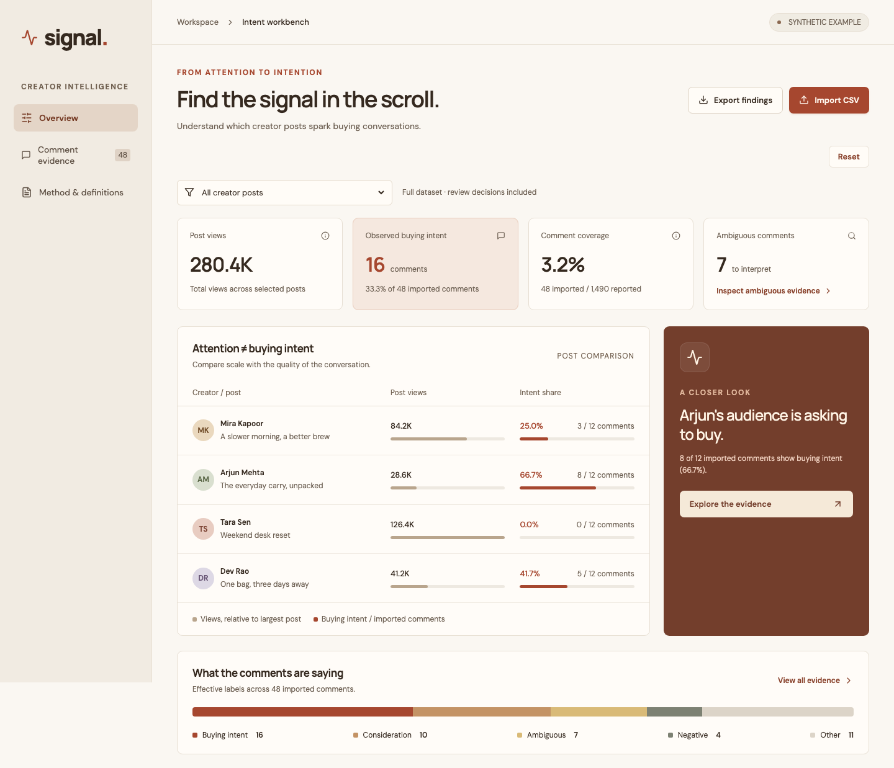

# Signal

**From creator attention to inspectable buying intent.**

Signal is a local-first workbench for exploring purchase-intent signals in creator post comments. It combines post-level engagement metrics with explainable comment classifications, human review, and evidence exports—so teams can look beyond view counts without confusing comments with sales.



## What it does

- **Compare posts:** See views, observed buying-intent share, and how much of each post's reported comment volume was imported.
- **Inspect the evidence:** Browse, search, and filter individual comments by post and category.
- **Understand each label:** See the rule ID, matched phrase, and explanation for each automatic classification.
- **Review decisions:** Override a category with a required reason or restore the automatic result.
- **Export findings:** Download post summaries or comment-level evidence, including both automatic and reviewed labels.
- **Import your own data:** Use a CSV template or start with the included synthetic example. Invalid imports do not replace your current dataset.

> **Demo data:** The initial dataset is synthetic: 4 fictional creators, 4 fictional posts, and 48 fictional comments. It does not represent real campaigns, customers, purchases, or business results.

## Getting started

**Requirements:** Node.js 22.12+ and npm.

```bash
npm ci
npm run dev
```

Open **http://127.0.0.1:5173** in your browser. No account, API keys, or environment variables are required.

### Tests and production build

```bash
npm test
npm run build

# Optional browser tests
npx playwright install chromium
npm run test:e2e

# Preview the production build
npm run preview
```

## How classification works

Signal currently uses **deterministic English-language phrase rules** (`rules-1.0`), not an LLM or trained prediction model.

| Category | Example of a signal |
| --- | --- |
| Buying intent | Explicit purchase actions, such as “where can I buy” |
| Consideration | Questions about price, size, shipping, fit, or availability |
| Negative | Supported negations or clear negative purchase language |
| Ambiguous | Uncertain or conditional interest; conflicting signals |
| Other | No supported phrase match |

Negated purchase language is handled before positive matching. Conditional or humorous purchase language may be labeled **Ambiguous**. Reviewers can adjust any category with a reason; the original automatic classification is retained in exports.

**Important:** These rules are heuristics. They are not validated as a measure of real purchase behavior. Sarcasm, slang, multilingual language, spam, and context-dependent meaning may be misclassified.

## Reading the metrics

- **Observed buying intent:** Imported comments whose effective (possibly reviewed) category is `Buying intent`.
- **Intent share:** Buying-intent comments ÷ imported comments for the same post.
- **Coverage:** Imported comments ÷ reported comments for the same post.
- **Views:** The sum of the supplied post view counts, counted once per post—not unique reach.

A missing denominator is shown as undefined, **not 0%**. Imported comments are not unique people or confirmed customers. Signal does **not** estimate purchases, conversions, or sales uplift.

## CSV import

Each CSV row represents a comment. Repeat the post information on each row; for posts with no imported comments, leave both comment fields empty.

| Column | Description |
| --- | --- |
| `post_id` | Non-empty post ID; repeated rows must use consistent post details |
| `creator` | Creator name |
| `post_title` | Post title |
| `views` | Non-negative whole number |
| `likes` | Non-negative whole number, no greater than views |
| `reported_comments` | Non-negative whole number, no smaller than the imported comment count |
| `comment_id` | Globally unique ID, or blank when comment text is blank |
| `comment_text` | Comment text, up to 10,000 characters; required when comment ID is supplied |
| `dataset_type` | Optional: `synthetic` or `user-supplied` (defaults to `user-supplied`) |

CSV files may be up to **5 MB and 10,000 data rows**. UTF-8, quoted fields and newlines, and UTF-8 BOMs are supported. Imports are validated before replacing the current dataset, and a successful import clears previous reviews.

Examples: [`signal-template.csv`](public/signal-template.csv) and [`signal-synthetic-example.csv`](public/signal-synthetic-example.csv).

## Technology and structure

Built with **React, TypeScript, Vite, Papa Parse, and Lucide**, with automated tests and Playwright browser scenarios.

```text
src/lib/engine.ts   CSV validation, classification, aggregation, exports
src/lib/demo.ts     Synthetic demo data and import template
src/App.tsx         Overview, evidence, import/export, and review UI
src/styles.css     Responsive styles
public/            Example CSVs and static assets
tests/             Unit/integration and browser tests
docs/              Screenshots and supporting notes
```

The classification and aggregation logic is separated from the UI into typed, testable functions.

## Privacy and current limitations

Signal processes imported data **in the browser**; it does not send it to a server. Data and review decisions are held in browser memory and **will be lost on refresh or close**, so export your work first.

This is a working prototype, not a production analytics service. It intentionally does not include authentication, persistent storage, social-platform integrations, scraping, AI calls, conversion attribution, or multi-user collaboration. Treat imported comments as potentially sensitive and only use data you have permission to process.

## Deploying to Vercel

The app builds as a static Vite site; no backend or secrets are needed.

1. Push this project to a GitHub repository.
2. Import the repository at [vercel.com/new](https://vercel.com/new).
3. Choose **Vite** as the framework preset and use:
   - **Install command:** `npm ci`
   - **Build command:** `npm run build`
   - **Output directory:** `dist`
   - **Node.js:** 22.x (22.12+)
4. Deploy and test the import, review, export, and mobile flows.

## Project status

Signal is an independent Product Engineering prototype built to explore how creator-campaign teams might examine intent-related evidence. Its example data is fictional, and no campaign performance or classifier-accuracy claims are made.
